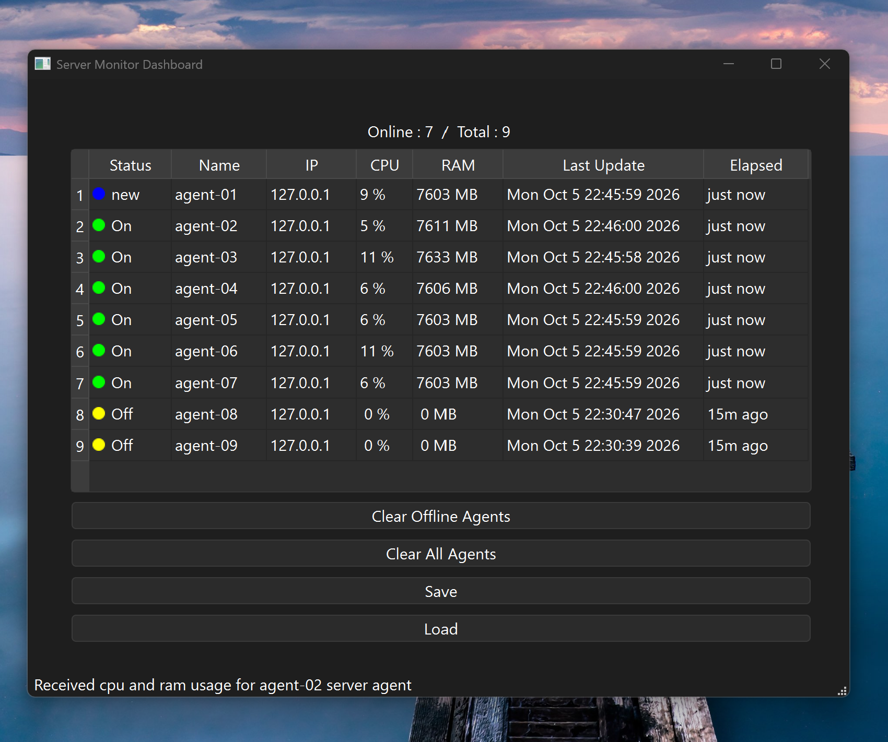
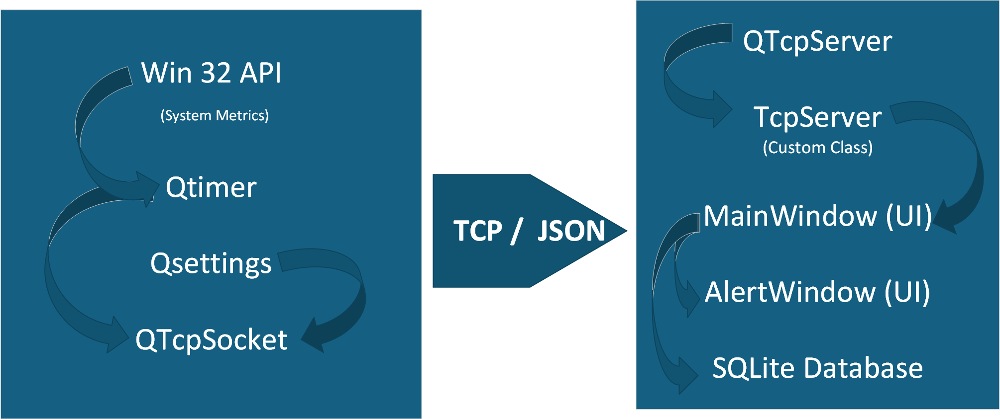

# ServerMonitor

A real-time server monitoring dashboard built with **Qt6** and **C++17**.

Agents run on remote machines, collect CPU, RAM, and Disk metrics, and send them over TCP to a central dashboard that displays live status for all connected servers. The system includes a dedicated Alert Window that triggers on high resource usage.




## Features

- Real-time CPU, RAM, and Disk monitoring
- Multi-agent support (tested with multiple simultaneous agents)
- TCP-based communication using structured JSON packets
- Live status indicators (New / Online / Offline)
- Relative time display (Elapsed column)
- Auto-sizing table columns for optimal readability
- **Alert system with fully configurable Warning and Critical thresholds**
- **Settings tab with dynamic threshold validation (Warning < Critical)**
- **Automatic Alert Window that restores on critical alerts**
- **Kick protocol: cleanly disconnects agents via JSON command**
- Manual simulation button for testing alerts
- Structured JSON export for data analysis
- Clear offline or all agents with one click


## Architecture



[Agent 1] ──TCP──┐
[Agent 2] ──TCP──┤
[Agent 3] ──TCP──┼──▶ [ServerMonitor Dashboard]
... │ │
[Agent N] ──TCP──┘ ▼
[Alert Window]
(Triggers on >80% / >90%)


- **ServerAgent**: A lightweight Qt application that runs on each monitored machine, collects local CPU, RAM, and Disk usage, and sends JSON-formatted metrics to the dashboard every 2 seconds.
- **ServerMonitor Dashboard**: A Qt-based GUI that listens for incoming agent connections, parses metrics, and displays them in a real-time table.
- **AlertWindow**: A separate, independent window that monitors incoming metrics. It highlights values that exceed the Warning (80%) or Critical (90%) thresholds and automatically hides itself when no active alerts remain.


## Requirements

- Qt 6.5 or higher
- CMake 3.16+
- C++17 compatible compiler (MinGW or MSVC)
- Windows 10/11 (for real CPU/RAM metrics via Windows API)


## How to Build

Open the project in Qt Creator and press Run.

Or build manually:

```
mkdir build && cd build
cmake ..
cmake --build .
```

## Docker Deployment

You can also run the dashboard as a headless Docker container (TCP service only):

```bash
docker build -t server-monitor-ui .
docker run -d --name server-monitor -p 12345:12345 server-monitor-ui
```

The container listens on port `12345` for incoming agent connections.
To stop the container, run `docker stop server-monitor`.

## How to Use

1. Start the **ServerMonitor Dashboard** — it will listen on port `12345`.
2. Start one or more **ServerAgent** instances (on the same machine or remote machines).
3. In each agent, set the dashboard's IP, port, and click **Connect**.
4. The agent will appear in the dashboard's table and start sending metrics every 2 seconds.
5. If any metric exceeds 80% (Warning) or 90% (Critical), the **Alert Window** will appear automatically.
6. Use the **Simulate Alert** button on the dashboard to test the Alert Window without overloading your system.


## Roadmap

- [x] TCP server and agent communication
- [x] Real CPU/RAM metrics via Windows API
- [x] Disk metrics
- [x] Status coloring and elapsed time display
- [x] Alert Window with Warning/Critical levels
- [x] Settings tab with dynamic thresholds
- [x] Kick protocol for clean disconnection
- [x] JSON export for reporting
- [ ] Historical logging and trend analysis
- [ ] Cross-platform agent (Linux/macOS)


## License

MIT License - see [LICENSE](LICENSE) file for details.
